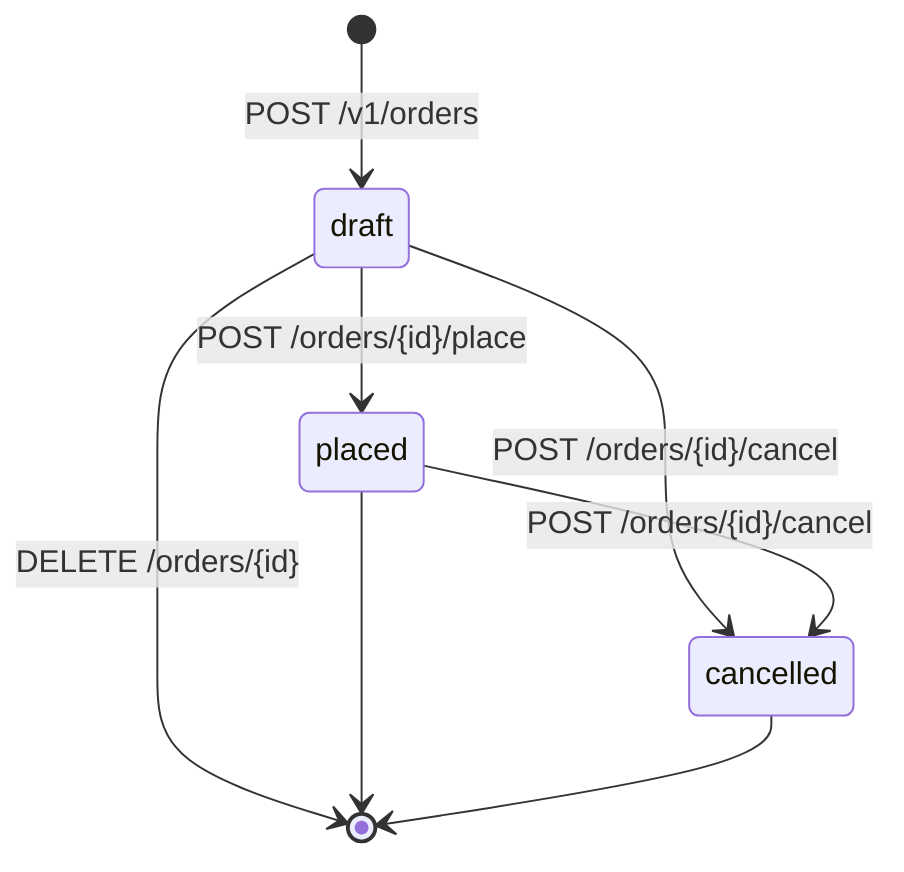

# gin-clean-arch-demo

Layered Go HTTP service: Gin transport, typesafe domain model, SQLite
persistence and Valkey (Redis-compatible) read-through caching.

## Layout

```
cmd/server/                 entrypoint: config, composition root, graceful shutdown
internal/domain/            entities, value types, validation, sentinel errors
internal/usecase/           application services + ports (repositories, Cache)
internal/logger/            zerolog construction + request-scoped logger in context
internal/adapter/sqlite/    GORM model (schema source of truth), store, repository
internal/adapter/cache/     Valkey/Redis implementation of the Cache port
internal/adapter/httpapi/
  server.go                 Server struct, router, http.Server with timeouts
  middleware.go             request id + structured access log
  handlers/
    handlers.go             Handler struct + the service ports it needs
    users.go                one handler per user endpoint, request/response types
    orders.go               order endpoints, ETag/If-Match preconditions
    health.go               readiness handler
    errors.go              domain error → status code mapping
internal/app/               composition root: build, run, graceful shutdown
internal/config/            caarlos0/env loader with defaults and validation
```

Dependencies point inward: `domain` imports nothing internal, `usecase`
defines the interfaces, adapters implement them, and `cmd/server` is the only
place that wires concrete types together.

## Persistence

SQLite through [GORM](https://gorm.io) with the pure-Go `glebarez/sqlite`
driver (no cgo). `internal/adapter/sqlite/model.go` is the schema's single
source of truth: column names, the `status` CHECK constraint, and both indexes
live on the struct tags, and `AutoMigrate` applies them at startup (idempotent,
so restarts are no-ops). `orders` and `order_items` add a foreign key with
`ON DELETE RESTRICT` to the customer, `ON DELETE CASCADE` to the lines, CHECK
constraints on status, quantity and price, and unique indexes on the order
number and on `(order_id, sku)` — so a duplicated line is a database error, not
a silently double-charged order. Timestamps are application-owned
(`autoCreateTime:false`/`autoUpdateTime:false`), so the domain decides when a
write happened. `TranslateError` maps unique violations to
`gorm.ErrDuplicatedKey`, which the repository converts to
`domain.ErrEmailTaken`.

## Types

`UserID`, `Email`, `DisplayName`, `UserStatus`, `OrderID`, `CurrencyCode`,
`SKU`, `Quantity` and `Cents` are distinct Go types. The only way to obtain a
valid value from untrusted input is a `Parse*` function, so validation cannot
be skipped by accident; `User` is built through `domain.NewUser` and
transitioned through `Rename` / `ChangeStatus`, and `Order` through
`NewOrder` / `ReplaceItems` / `Place` / `Cancel`.

### Orders

An order is an aggregate: its lines are reachable only through the order, and
every mutation goes through a method that enforces the lifecycle, so an
illegal transition is impossible to construct:



Only drafts are editable and deletable. A placed order is a record of what a
customer bought, so it is frozen and must be cancelled rather than erased.

Money is integer minor units (`unit_price_cents`, `total_cents`,
`line_total_cents`); no float ever touches a price, so totals are exact.
Quantities are 1–1000, prices are 0–99,999,999, and a duplicated SKU inside one
order is rejected. Line order is preserved.

Order writes are **conditionally** applied. Every order has a `version` that
increments on each change; responses carry it in an `ETag`, and a write may
echo that value back in `If-Match`. The comparison and the increment happen in
one transaction in SQLite, so two concurrent writers cannot both win:

| Situation                                   | Status |
| ------------------------------------------- | ------ |
| `If-Match` names a stale version            | 412    |
| transition the current state forbids        | 409    |
| order or customer does not exist            | 404    |

`If-Match` is optional: without it the service still compares against the
version it just read, which narrows the window but cannot close it. Send the
header when correctness matters.

Orders reference their customer through a foreign key with
`ON DELETE RESTRICT`, so deleting a user that still owns orders is a 409 rather
than an orphan row. Only active (non-suspended) customers can start an order.

## Logging

[zerolog](https://github.com/rs/zerolog) writes one event per line. Every layer
owning a log line adds its own `layer` field, and requests carry `request_id`
(echoed in `X-Request-ID`) so handler and service lines can be joined:

```json
{"level":"info","layer":"usecase","op":"create_user","request_id":"trace-777",
 "method":"POST","path":"/v1/users","user_id":"01a1…","message":"user created"}
{"level":"info","layer":"http","request_id":"trace-777","method":"POST",
 "path":"/v1/users","status":201,"bytes":201,"duration_ms":1.378,
 "client_ip":"127.0.0.1","message":"http request"}
```

- `internal/logger` owns construction, level/format parsing and the context
  plumbing (`WithLogger`, `WithRequestID`); the usecase reads the request
  logger with `logger.FromContext`, so no `slog` globals leak across requests.
- The access log's level follows the status code (5xx error, 4xx warn).
- `LOG_FORMAT=console` gives colourised human output for local runs.

## API

| Method | Path            | Description                          |
| ------ | --------------- | ------------------------------------ |
| GET    | `/healthz`      | DB + cache readiness (503 if down)   |
| GET    | `/docs/index.html` | Interactive Swagger UI            |
| POST   | `/v1/users`     | Create a user → 201 + `Location`     |
| GET    | `/v1/users`     | List: `limit`, `offset`, `status`    |
| GET    | `/v1/users/:id` | Fetch one (cache-backed)             |
| PATCH  | `/v1/users/:id` | Update `display_name` and/or `status`|
| DELETE | `/v1/users/:id` | Delete → 204; 409 if the user has orders |
| POST   | `/v1/orders`    | Create a draft order → 201 + `Location` + `ETag` |
| GET    | `/v1/orders`    | List: `limit`, `offset`, `status`, `customer_id` |
| GET    | `/v1/orders/:id`| Fetch one (cache-backed) + `ETag`    |
| PUT    | `/v1/orders/:id/items` | Replace the lines of a draft  |
| POST   | `/v1/orders/:id/place` | Draft → placed                |
| POST   | `/v1/orders/:id/cancel`| Draft or placed → cancelled   |
| DELETE | `/v1/orders/:id`| Delete a draft → 204                  |

Errors are `{"error": "...", "field": "..."}` with 400 (validation),
404 (missing), 409 (duplicate email, or a state the operation forbids),
412 (stale `If-Match`), 500 (unexpected, logged server side).

## API documentation

Swagger UI is served at `/docs/index.html` and the generated document at
`/docs/doc.json`. It is interactive: "Try it out" issues real requests.

The specification is generated from annotations, so the handlers are the single
source of truth: general metadata lives on `cmd/server/main.go`, and each
handler in `internal/adapter/httpapi/handlers` carries `@Summary`, `@Param`,
`@Success` and `@Failure`. Request and response schemas come from the Go types
themselves, so a handler and its schema cannot drift apart.

```sh
make docs        # regenerate
make docs-check  # fail if the committed spec is stale
```

`swag` is pinned in `go.mod` as a tool dependency, so the target needs no
install and every checkout generates identical output. `make docs-check` is
suitable for CI: it generates into a scratch directory, so a stale spec fails
the build without touching the working copy. Commit the regenerated
`internal/adapter/httpapi/docs` directory; the binary embeds it, so the docs
work without a build step at deploy time.

`swagger_test.go` fails when a route is added without annotations, when a
documented operation no longer exists, or when a `$ref` does not resolve — so
the docs cannot silently drift from the routes.

## Configuration

Configuration comes from the environment. For local work, copy the template:

```sh
cp .env.example .env
```

`config.Parse` reads `.env` when it exists and then the process environment;
**exported variables win over the file**, so `CACHE_ADDR=localhost:6380 go run
./cmd/server` overrides it and deployed environments need no file at all. The
file is optional: if it is missing, startup proceeds with defaults. A malformed
file is an error, not a silent skip.

| Variable              | Default          | Meaning                              |
| --------------------- | ---------------- | ------------------------------------ |
| `HTTP_ADDR`           | `:8080`          | listen address                       |
| `DATABASE_PATH`       | `data/app.db`    | SQLite file (`:memory:` for scratch) |
| `DATABASE_MAX_CONNS`  | `4`              | connection pool size                 |
| `DATABASE_BUSY_TIMEOUT` | `5s`           | SQLite lock wait                     |
| `DATABASE_LOG_SQL`    | `false`          | log every statement at debug         |
| `CACHE_ADDR`          | `127.0.0.1:6379` | Valkey/Redis address                 |
| `CACHE_PASSWORD`      | –                | optional AUTH password               |
| `CACHE_DB`            | `0`              | logical database index               |
| `CACHE_TTL`           | `5m`             | cached user lifetime (≤0 disables)   |
| `CACHE_TIMEOUT`       | `2s`             | dial/read/write timeout              |
| `SHUTDOWN_TIMEOUT`    | `10s`            | graceful shutdown budget             |
| `LOG_LEVEL`           | `info`           | `trace`…`panic`                      |
| `LOG_FORMAT`          | `json`           | `json` (production) or `console`     |
| `GIN_MODE`            | –                | set `release` to silence route logs  |

## Run

```sh
cp .env.example .env      # optional; tweak addresses and log format
docker compose up -d valkey
go run ./cmd/server
```

`go run` looks for `.env` in the working directory, so run it from the
repository root.

```sh
curl -sS localhost:8080/v1/users \
  -H 'Content-Type: application/json' \
  -d '{"email":"ada@example.com","display_name":"Ada Lovelace"}'
```

Then create and place an order as that customer:

```sh
# create: keep the ETag, it is the precondition for later writes
curl -sS -D - localhost:8080/v1/orders \
  -H 'Content-Type: application/json' \
  -d '{"customer_id":"<id>","currency":"USD",
       "items":[{"sku":"WIDGET-01","quantity":2,"unit_price_cents":1999}]}'

curl -sS -X POST localhost:8080/v1/orders/<id>/place -H 'If-Match: "v1"'
```

## Test

```sh
go test ./...        # uses a temp SQLite file and an in-process Redis (miniredis)
go test -race ./...
```
